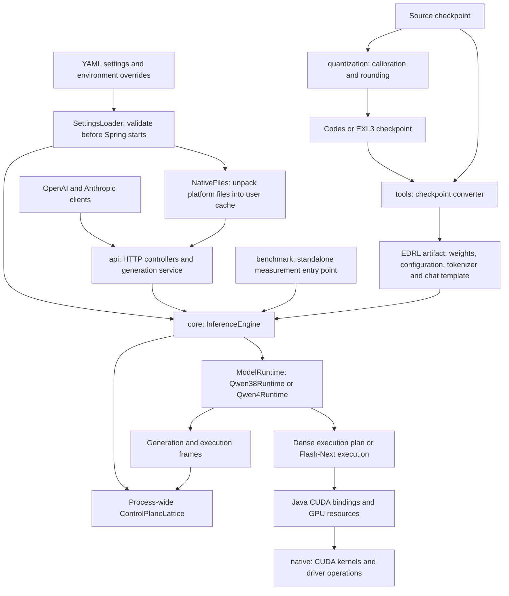

# System architecture

This map shows deployment boundaries and the main responsibilities checked at commit `498f7d2c`. Arrows describe runtime use or artifact flow. The detailed execution diagrams focus on dense Qwen3.8; Qwen4/Flash-Next has its own runtime and expert storage hierarchy.

`InferenceEngine` owns the lifecycle of the process fabric and sessions. Dense loading opens the GPU and model before starting the lattice; Flash-Next starts the lattice and lets `Qwen4Runtime` own its GPU and storage resources. The lattice schedules host work; CUDA streams and events govern device work.

The server reads one settings tree before starting Spring. YAML and per-key environment overrides supply model, sampling, batching, memory, host, kernel and HTTP settings. Invalid settings stop startup. The platform JAR carries the CUDA binding, CUDA runtime, NVRTC, kernel sources, headers and llguidance; `NativeFiles` unpacks them into a content-addressed user cache. The host supplies the NVIDIA driver. `InferenceConfig.of` combines settings with the unpacked paths.

Both model runtimes load the tokenizer and chat template from the artifact's tokenizer section; a missing or invalid section fails startup with a diagnostic. Serving needs no separate checkpoint directory. Sampling defaults come from settings, with request values overriding them. Execution strategy and weight formats come from the artifact, while batching, memory limits and kernel thresholds come from settings.

Quantization is an offline application. It reuses inference kernels and lattice machinery, then supplies rounded codes to the Python converter. It is not a request stage in the serving process. `native` and `tools` are repository directories rather than additional Gradle subprojects.

## Implementation anchors

- [Gradle modules](../../settings.gradle.kts): `core`, `api`, `benchmark`, `quantization`. API and benchmark depend on core; quantization also depends on API for tooling reuse.
- [InferenceEngine](../../core/src/main/java/io/euhedral_execution/inference/core/InferenceEngine.java): `load`, `loadQwen4`, session tracking and shutdown.
- [Application startup](../../api/src/main/java/io/euhedral_execution/inference/api/EuhedralInferenceApplication.java), [SettingsLoader](../../core/src/main/java/io/euhedral_execution/inference/core/settings/SettingsLoader.java), [InferenceConfig](../../core/src/main/java/io/euhedral_execution/inference/core/InferenceConfig.java) and [NativeFiles](../../core/src/main/java/io/euhedral_execution/inference/core/nativefiles/NativeFiles.java).
- [TokenizerSection](../../core/src/main/java/io/euhedral_execution/inference/core/artifact/TokenizerSection.java): embedded tokenizer validation and upgrade diagnostics.
- [Qwen38Runtime](../../core/src/main/java/io/euhedral_execution/inference/core/model/qwen38/Qwen38Runtime.java): plan, execution, prefix cache and speculative strategy.
- [Qwen4Runtime](../../core/src/main/java/io/euhedral_execution/inference/core/model/qwen4/Qwen4Runtime.java): Flash-Next resource ownership.
- [Quantization workflow](../../quantization/README.md) and [converter](../../tools/convert_checkpoint.py).

This diagram omits individual layers, kernel variants, request state transitions and physical memory layout. Those are covered by the focused diagrams in this directory.
