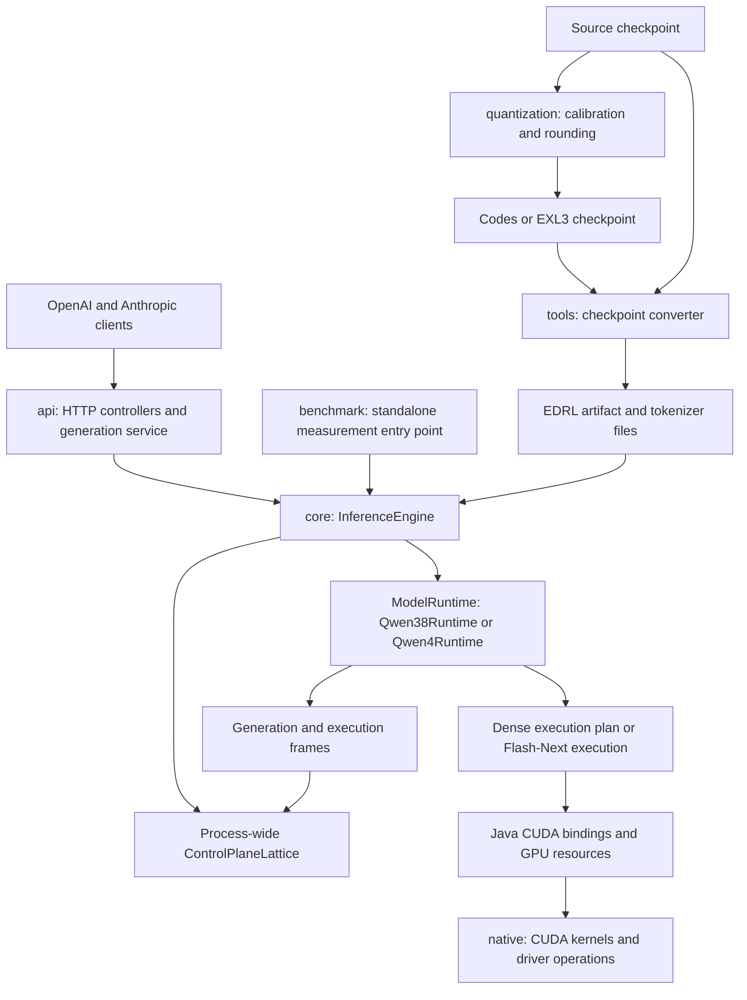

# System architecture

This map shows deployment boundaries and the main responsibilities at commit `22aa9e12`. Arrows describe runtime use or artifact flow, not every Java dependency. The detailed execution diagrams focus on dense Qwen3.8; Qwen4/Flash-Next has its own runtime and expert storage hierarchy.

`InferenceEngine` owns the lifecycle of the process fabric and sessions. Dense loading opens the GPU and model before starting the lattice; Flash-Next starts the lattice and lets `Qwen4Runtime` own its GPU and storage resources. The lattice schedules host work; CUDA streams and events govern device work.

Quantization is an offline application. It reuses inference kernels and lattice machinery, then supplies rounded codes to the Python converter. It is not a request stage in the serving process. `native` and `tools` are repository directories rather than additional Gradle subprojects.

## Implementation anchors

- [Gradle modules](../../settings.gradle.kts): `core`, `api`, `benchmark`, `quantization`. API and benchmark depend on core; quantization also depends on API for tooling reuse.
- [InferenceEngine](../../core/src/main/java/io/euhedral_execution/inference/core/InferenceEngine.java): `load`, `loadQwen4`, session tracking and shutdown.
- [Qwen38Runtime](../../core/src/main/java/io/euhedral_execution/inference/core/model/qwen38/Qwen38Runtime.java): plan, execution, prefix cache and speculative strategy.
- [Qwen4Runtime](../../core/src/main/java/io/euhedral_execution/inference/core/model/qwen4/Qwen4Runtime.java): Flash-Next resource ownership.
- [Quantization workflow](../../quantization/README.md) and [converter](../../tools/convert_checkpoint.py).

This diagram omits individual layers, kernel variants, request state transitions and physical memory layout. Those are covered by the focused diagrams in this directory.
