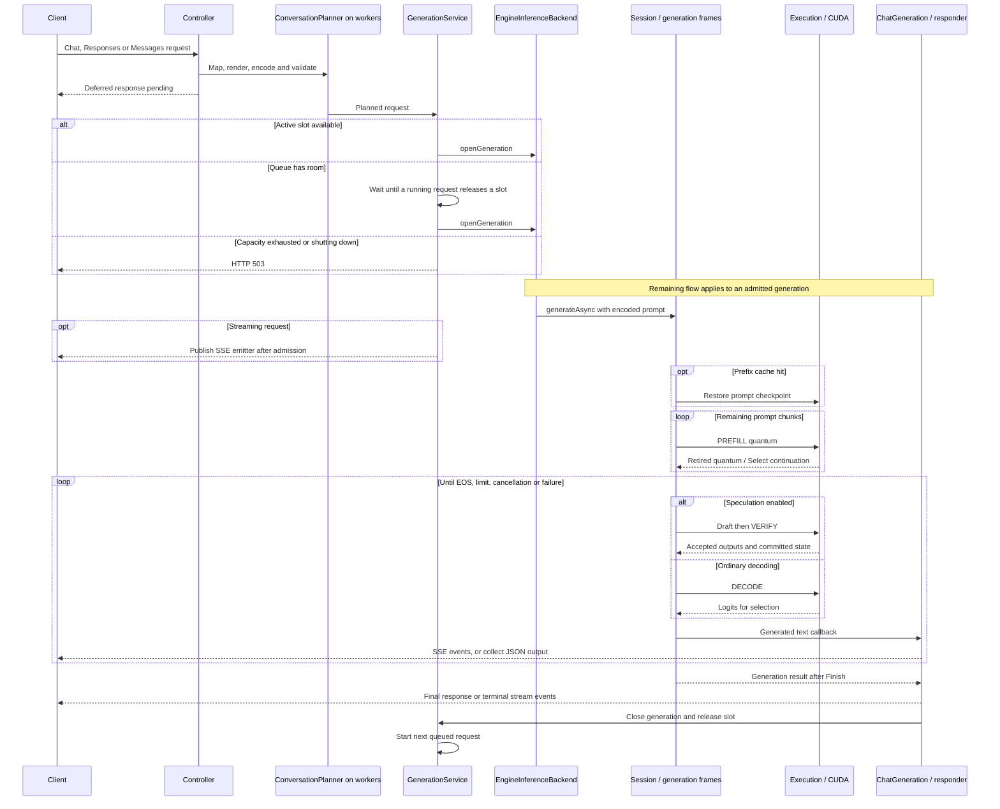

# Request lifecycle

This diagram follows an API generation from HTTP admission to response completion. The engine steps shown are the dense Qwen3.8 path. Planning occurs before the service reserves a generation slot.

`GenerationService` bounds active requests by `maxActiveGenerations()` and waiting requests by `maxQueuedGenerations`. Validation failures reach the HTTP error handler before an emitter is published. Client disconnects, request timeouts and shutdown stop generation or remove the waiting admission; completion releases the session and slot.

The core generation chain is `Admit → quantum → Select → Admit/Finish`. A session can skip a quantum when a step needs no device work. The first output can come from prompt logits; the diagram groups that selection with generation rather than implying an extra decode is always required.

## Implementation anchors

- [Controllers](../../api/src/main/java/io/euhedral_execution/inference/api/web/OpenAiController.java) and [AnthropicController](../../api/src/main/java/io/euhedral_execution/inference/api/web/AnthropicController.java).
- [ConversationPlanner](../../api/src/main/java/io/euhedral_execution/inference/api/chat/ConversationPlanner.java), [GenerationService](../../api/src/main/java/io/euhedral_execution/inference/api/chat/GenerationService.java) and [ChatGeneration](../../api/src/main/java/io/euhedral_execution/inference/api/chat/ChatGeneration.java).
- [EngineInferenceBackend](../../api/src/main/java/io/euhedral_execution/inference/api/engine/EngineInferenceBackend.java): constraints, session creation and callbacks.
- [Generation](../../core/src/main/java/io/euhedral_execution/inference/core/generation/Generation.java) and [Session](../../core/src/main/java/io/euhedral_execution/inference/core/model/qwen38/Session.java).

This diagram omits protocol-specific event schemas, tool parsing and individual execution stages. See [execution engine](03-execution-engine.md) and [speculative decoding](05-speculative-decoding.md).
