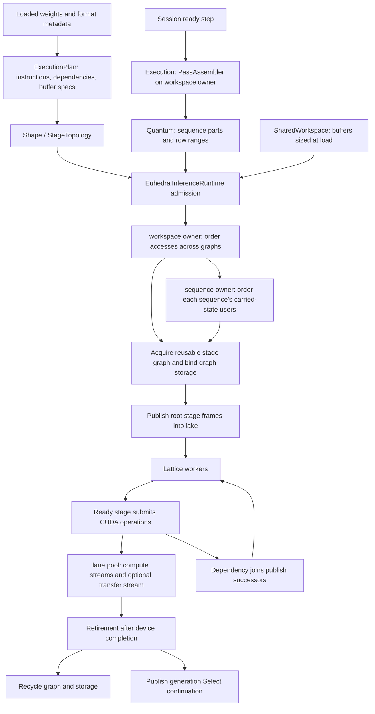

# Execution engine

The dense engine separates model instructions, a quantum's invocation data, reusable graph storage and persistent sequence state. A quantum is a prefill, decode, verification or draft unit of device work; several ready sequences can contribute parts to one pass.

`ExecutionPlan.Instruction` names operation kind, weights, input/output buffers and predecessor IDs. The plan borrows weights; it does not own a session's KV/GDN state or the shared workspace. Buffer storage slots allow reuse, with access ordering supplied by the runtime.

`Execution` assembles ready offers into passes constrained by row and part limits. Admission runs in the ordering domain of the workspace owner's hash. `EuhedralInferenceRuntime` obtains a graph of the requested shape, prepares its quantum on the home lane and connects workspace accesses to earlier graphs. Stages then publish their own successors; there is no central stage dispatch loop.

Binding also connects first users of carried sequence state to its prior users through sequence owner: layer KV/GDN state, draft seed rows, device draft tokens, DFlash2 state and any shared device region for host KV pages. This permits several quanta of one sequence in flight when their host readback buffers are distinct and they do not share an unordered proposal. MTP uses this to admit a step's catch-up and drafts ahead of verification. Sequence conclusions still commit in admission order.

CUDA stream ordering, events and graph replay provide device ordering. A stage finishing its submission does not by itself prove the GPU finished. Eligible decode, verification and draft shapes can be captured and replayed as CUDA graphs; prompt work uses its prompt shapes and chunking.

Disk-backed quanta use stage submissions rather than graph replay: a disk transfer is released when its asynchronous read arrives. `DiskReader` registers uses in admission order and tracks readiness and reuse per window slot. The read backend is selected for the operating system; worker polling completes reads without a thread per request.

## Implementation anchors

- [plan](../../rust/crates/engine/src/plan/mod.rs), [pass assembler](../../rust/crates/engine/src/pass_assembler.rs) and [workspace](../../rust/crates/engine/src/workspace.rs): the execution plan, passes and the shared workspace.
- [runtime](../../rust/crates/engine/src/runtime.rs): admission, graph pooling and lanes.
- [stages](../../rust/crates/engine/src/stages/mod.rs), [frames](../../rust/crates/engine/src/frames.rs) and [quantum](../../rust/crates/engine/src/quantum/mod.rs): stage bodies, frames and the quantum.
- [CUDA graph contract](../kernels/CUDA_GRAPHS.md) and [frame model](FRAME_MODEL.md).

This diagram omits individual transformer operators and kernel selection. See [memory](04-memory-architecture.md), [CUDA](07-cuda-execution.md) and [ownership](08-concurrency-and-ownership.md).
