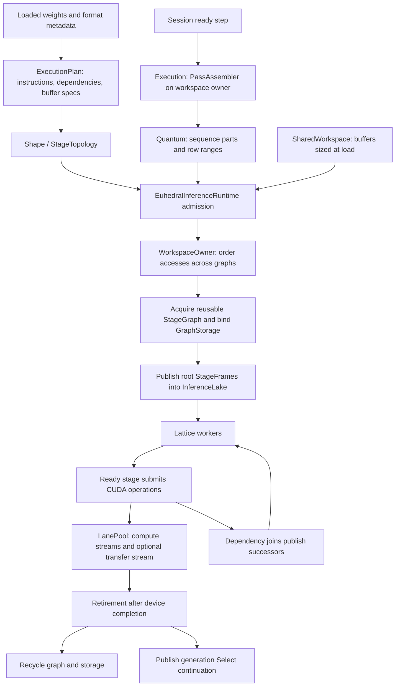

# Execution engine

The dense engine separates model instructions, a quantum's invocation data, reusable graph storage and persistent sequence state. A quantum is a prefill, decode, verification or draft unit of device work; several ready sequences can contribute parts to one pass.

`ExecutionPlan.Instruction` names operation kind, weights, input/output buffers and predecessor IDs. The plan borrows weights; it does not own a session's KV/GDN state or the shared workspace. Buffer storage slots allow reuse, with access ordering supplied by the runtime.

`Execution` assembles ready offers into passes constrained by row and part limits. Admission runs in the ordering domain of `WorkspaceOwner.HASH`. `EuhedralInferenceRuntime` obtains a graph of the requested shape, prepares its quantum on the home lane and connects workspace accesses to earlier graphs. Stages then publish their own successors; there is no central stage dispatch loop.

CUDA stream ordering, events and graph replay provide device ordering. A Java stage finishing its submission does not by itself prove the GPU finished. Eligible decode, verification and draft shapes can be captured and replayed as CUDA graphs; prompt work uses its prompt shapes and chunking.

## Implementation anchors

- [ExecutionPlan](../../core/src/main/java/io/euhedral_execution/inference/core/model/qwen38/ExecutionPlan.java), [Execution](../../core/src/main/java/io/euhedral_execution/inference/core/model/qwen38/Execution.java), [PassAssembler](../../core/src/main/java/io/euhedral_execution/inference/core/model/qwen38/PassAssembler.java) and [SharedWorkspace](../../core/src/main/java/io/euhedral_execution/inference/core/model/qwen38/SharedWorkspace.java).
- [EuhedralInferenceRuntime](../../core/src/main/java/io/euhedral_execution/inference/core/runtime/EuhedralInferenceRuntime.java): admission, graph pooling and lanes.
- [StageGraph](../../core/src/main/java/io/euhedral_execution/inference/core/runtime/graph/StageGraph.java), [StageFrame](../../core/src/main/java/io/euhedral_execution/inference/core/runtime/graph/StageFrame.java) and [WorkspaceOwner](../../core/src/main/java/io/euhedral_execution/inference/core/runtime/graph/WorkspaceOwner.java).
- [CUDA graph contract](../CUDA_GRAPHS.md) and [frame model](../FRAME_MODEL.md).

This diagram omits individual transformer operators and kernel selection. See [memory](04-memory-architecture.md), [CUDA](07-cuda-execution.md) and [ownership](08-concurrency-and-ownership.md).
