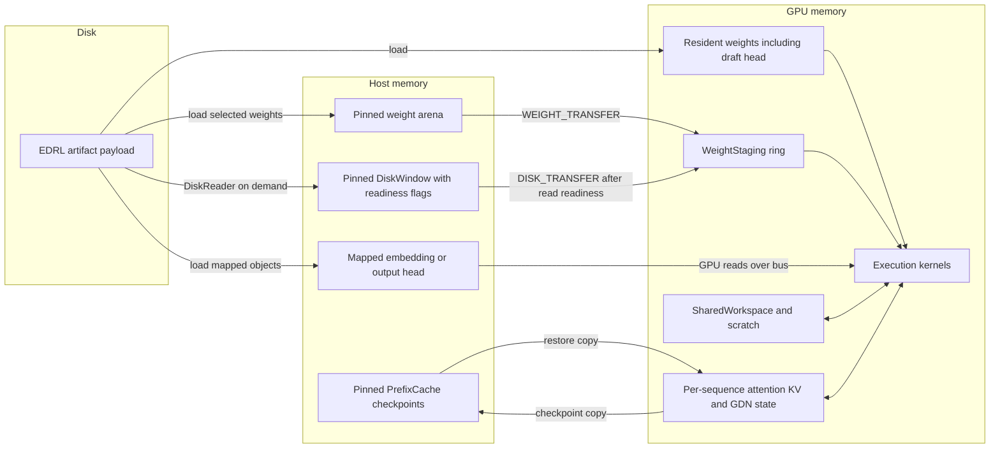

# Memory architecture

This is the dense Qwen3.8 weight and state hierarchy. Residency is planned at load from free device memory, artifact formats, context length, sequence count and a host budget. Flash-Next uses a separate expert cache hierarchy; see its existing [residency design](../FLASH_NEXT_RESIDENCY.md).

`ResidencyPlanner` reserves room for KV pages, sequence state, workspaces, staging, scratch and modules, then chooses an offloaded weight selection that fits. Selected weights occupy pinned host memory up to the host budget; remaining supported weights stay in the artifact and use a pinned disk window. The planner can refuse a configuration that cannot fit its required resources.

`WeightStaging` currently defines four aligned device slots. Transfers follow each slot's last reader, including readers in previously admitted graphs. A consumer follows its transfer. Disk-backed transfers also wait for the corresponding window payload to become ready. These dependencies protect reuse while allowing copies ahead of compute.

The embedding is a gather and can be read from mapped host storage. The output head is too large for ordinary staging slots and can be mapped as a last resort (or earlier through the diagnostic property). The draft head stays resident. These mapped accesses differ from ordinary host-backed projections copied into staging.

Weights and the shared workspace belong to the loaded model/execution. KV and GDN state belong to sequences. The optional prefix cache holds reusable prompt checkpoints in pinned host memory, with copies scheduled through the runtime; it is separate from weight offload.

## Implementation anchors

- [ResidencyPlanner](../../core/src/main/java/io/euhedral_execution/inference/core/model/qwen38/loader/ResidencyPlanner.java), [HostWeightSelection](../../core/src/main/java/io/euhedral_execution/inference/core/model/qwen38/loader/HostWeightSelection.java) and [WeightLoader](../../core/src/main/java/io/euhedral_execution/inference/core/model/qwen38/loader/WeightLoader.java).
- [WeightStaging](../../core/src/main/java/io/euhedral_execution/inference/core/artifact/WeightStaging.java), [DiskWindow](../../core/src/main/java/io/euhedral_execution/inference/core/model/qwen38/offload/DiskWindow.java) and [DiskReader](../../core/src/main/java/io/euhedral_execution/inference/core/model/qwen38/offload/DiskReader.java).
- [Sequence](../../core/src/main/java/io/euhedral_execution/inference/core/model/qwen38/Sequence.java), [AttentionKvState](../../core/src/main/java/io/euhedral_execution/inference/core/state/AttentionKvState.java) and [PrefixCache](../../core/src/main/java/io/euhedral_execution/inference/core/model/qwen38/prefix/PrefixCache.java).

This diagram shows ownership and data movement, not a fixed allocation size or a performance prediction. Actual byte budgets depend on the artifact and configured context.
