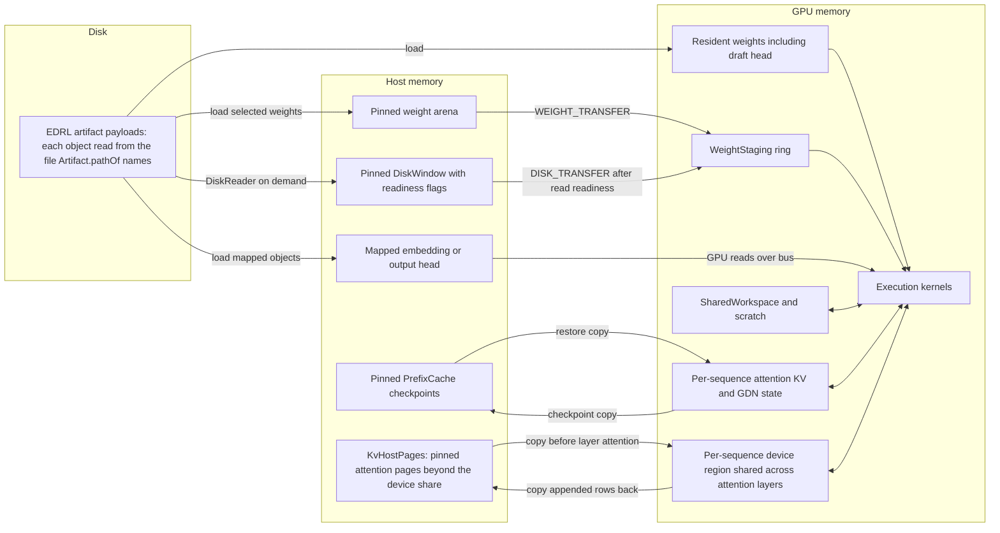

# Memory architecture

This is the dense Qwen3.8 weight and state hierarchy. Residency is planned at load from free device memory, artifact formats, context length, sequence count and a host budget. Flash-Next uses a separate expert cache hierarchy; see its existing [residency design](../flash-next/FLASH_NEXT_RESIDENCY.md).

`ResidencyPlanner` reserves room for KV pages, sequence state, workspaces, staging, scratch and modules, then chooses an offloaded weight selection that fits. Selected weights occupy pinned host memory up to the host budget; remaining supported weights stay in the artifact and use a pinned disk window. The planner can refuse a configuration that cannot fit its required resources.

If the full cache and weights do not fit, the planner first tries spilling attention pages beyond `context.kv-cache-on-gpu-tokens` into pinned host memory within the host budget. Each sequence slot keeps host pages per attention layer and one device region reused across those layers. Before attention, the layer's visible host pages are copied into that region; appended rows are copied back afterward. Carried-state edges order reuse across layers and quanta. If spilling cannot cover the deficit, the planner also offloads weights. The cache format (`context.kv-cache-format`) can be NVFP4 or BF16; NVFP4 uses H256-rotated INT4 midrise codes with E4M3 scales.

`WeightStaging` currently defines four aligned device slots. Transfers follow each slot's last reader, including readers in previously admitted graphs. A consumer follows its transfer. Disk-backed transfers also wait for the corresponding window payload to become ready. These dependencies protect reuse while allowing copies ahead of compute.

Every payload read resolves its file per object through `Artifact.pathOf`: a plain `.edrl` reads everything from itself, while an artifact assembled from several calibrated sources (the quantization module's `assemble`) names a source file for each object it took elsewhere. Loading, segment validation, host-backed staging and `DiskReader` all read through it; `DiskReader` opens each named file once.

The embedding is a gather and can be read from mapped host storage. The output head is too large for ordinary staging slots and can be mapped as a last resort when the other offloadable weights have left the device. The draft head stays resident. These mapped accesses differ from ordinary host-backed projections copied into staging.

Weights and the shared workspace belong to the loaded model/execution. KV and GDN state belong to sequences. The optional prefix cache holds reusable prompt checkpoints in pinned host memory, with copies scheduled through the runtime; it is separate from weight offload.

With host KV pages, prefix checkpoints stop at the device-resident page frontier. Runtime-owned pinned upload/readback buffers return to a capacity cache on release; they remain allocated until the pool is trimmed or the GPU closes, avoiding a synchronizing pinned free in worker progress.

## Implementation anchors

- [Artifact](../../core/src/main/java/io/euhedral_execution/inference/core/model/qwen38/artifact/Artifact.java): per-object source files.
- [ResidencyPlanner](../../core/src/main/java/io/euhedral_execution/inference/core/model/qwen38/loader/ResidencyPlanner.java), [HostWeightSelection](../../core/src/main/java/io/euhedral_execution/inference/core/model/qwen38/loader/HostWeightSelection.java) and [WeightLoader](../../core/src/main/java/io/euhedral_execution/inference/core/model/qwen38/loader/WeightLoader.java).
- [WeightStaging](../../core/src/main/java/io/euhedral_execution/inference/core/artifact/WeightStaging.java), [DiskWindow](../../core/src/main/java/io/euhedral_execution/inference/core/model/qwen38/offload/DiskWindow.java) and [DiskReader](../../core/src/main/java/io/euhedral_execution/inference/core/model/qwen38/offload/DiskReader.java).
- [Sequence](../../core/src/main/java/io/euhedral_execution/inference/core/model/qwen38/Sequence.java), [AttentionKvState](../../core/src/main/java/io/euhedral_execution/inference/core/state/AttentionKvState.java) and [PrefixCache](../../core/src/main/java/io/euhedral_execution/inference/core/model/qwen38/prefix/PrefixCache.java).
- [KvHostPages](../../core/src/main/java/io/euhedral_execution/inference/core/state/KvHostPages.java), [Shape carried-state keys](../../core/src/main/java/io/euhedral_execution/inference/core/model/qwen38/Shape.java) and [memory settings](../../core/src/main/java/io/euhedral_execution/inference/core/settings/MemorySettings.java).

This diagram shows ownership and data movement, not a fixed allocation size or a performance prediction. Actual byte budgets depend on the artifact and configured context.
