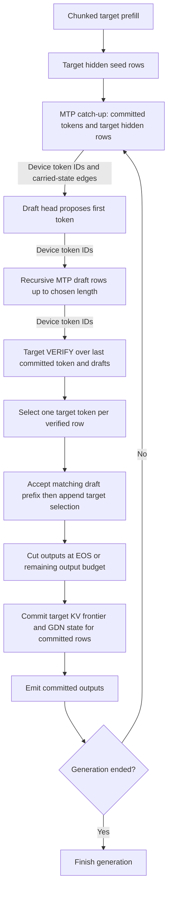

# Speculative decoding

This diagram follows dense Qwen3.8 MTP. Drafts propose tokens; row-exact target verification determines the outputs and the persistent target state. An artifact may instead select DFlash2 through the common speculative strategy interface.

For inputs `[t0, d1, ..., dn]`, row `j` selects target token `g_j`. Accept drafts while `d_(j+1) == g_j`; then output the matching drafts and the next target selection. If all drafts match, the final verified row supplies a bonus token. `SpeculativeAcceptance` also truncates at EOS and the output budget.

Committed **input rows** equal the output count. For `k` outputs, the target has consumed `t0` and the first `k-1` outputs; the last output becomes the next anchor and has not yet been fed. The sequence frontier and GDN recurrent state must match precisely that prefix, and speculative KV beyond that frontier is not committed history.

MTP catch-up commits its cache rows using the verified target hidden states. Recursive proposal rows do not commit MTP history. Prompt chunks also receive catch-up; earlier chunks can run ahead subject to carried-state dependencies and prefix checkpoint boundaries.

After a verification, the normal fixed-length MTP path admits the next catch-up, recursive drafts and verification together. Draft selections map through the vocabulary shortlist on the device and feed later embeddings without a host selection round trip. Each draft has its own readback buffer; `SequenceOwner` orders seed rows, MTP cache and device tokens across graphs. Only verification publishes the generation continuation. This path requires device token passing, no draft observer, an ungated length and verification of the full drafted length; diagnostic paths that do not meet those conditions retire drafts separately. The diagram's arrows express data dependencies, which remain present when all quanta are admitted ahead.

`Qwen38Runtime` chooses MTP, DFlash2 or ordinary decoding from the artifact profile, available draft weights and session options. The MTP draft length is the depth the artifact stores when it stores one; otherwise the policy measured for its quantization. `ArtifactProfile` reads the quantization from every text-layer projection, and an artifact whose projections mix formats (`MIXED`) must store its depth: the engine refuses MTP for one that does not, rather than inferring a depth from the formats present. DFlash2 replaces MTP proposal construction with target taps and a block drafter; acceptance remains target verification. Selection supports greedy tokens and a position-aware sampled selector; exactness means agreement with the corresponding ordinary target execution.

## Implementation anchors

- [MtpDecoder](../../core/src/main/java/io/euhedral_execution/inference/core/model/qwen38/speculative/MtpDecoder.java): prefill, catch-up, recursion and verification step ports.
- [SpeculativeAcceptance](../../core/src/main/java/io/euhedral_execution/inference/core/model/qwen38/speculative/SpeculativeAcceptance.java): matching, truncation and committed row count.
- [Quantum](../../core/src/main/java/io/euhedral_execution/inference/core/model/qwen38/Quantum.java) and [Sequence](../../core/src/main/java/io/euhedral_execution/inference/core/model/qwen38/Sequence.java): retirement and state commit.
- [ArtifactProfile](../../core/src/main/java/io/euhedral_execution/inference/core/model/qwen38/ArtifactProfile.java): quantization, speculation and the stored draft depth.
- [Qwen38Runtime](../../core/src/main/java/io/euhedral_execution/inference/core/model/qwen38/Qwen38Runtime.java) and [DFlash2Decoder](../../core/src/main/java/io/euhedral_execution/inference/core/model/qwen38/speculative/DFlash2Decoder.java).
- [MTP contract](../speculation/MTP_CONTRACT.md), [verifier](../speculation/MTP_VERIFIER.md) and [DFlash2](../speculation/DFLASH2.md).

Fresh unconstrained sessions use speculation only when the strategy supports their sampling mode. MTP supports position-aware sampling; constrained sessions use ordinary execution. At an output-token limit, a final feed consumes the last emitted token without selecting another so the final state agrees with ordinary decoding. Cancellation returns the outputs already committed.

The row-exact contract covers logits and state as well as final token agreement. Existing CUDA integration tests exercise it. Kernel variants and checkpoint byte layouts are outside this diagram.
