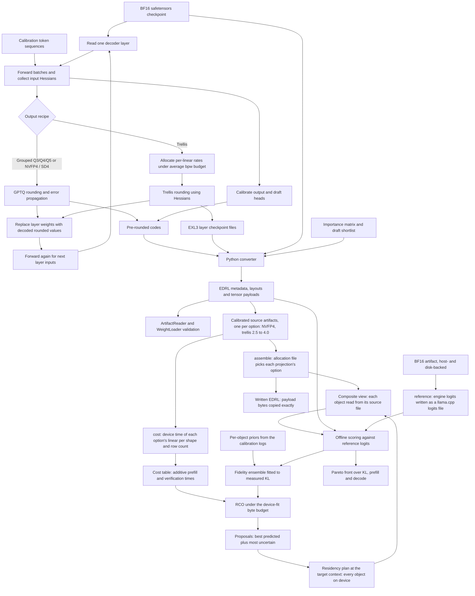

# Quantization and artifact creation

This diagram covers the offline dense Qwen3.8 pipeline. Calibration learns rounding from activations; conversion packs the selected representations into an EDRL artifact consumed by the engine.

The loop is layerwise: collect statistics, round, substitute decoded weights and propagate the resulting activations. Hidden states live in pinned host storage and support resume checkpoints. Calibration work runs as lattice frames with CUDA streams; cuBLAS/cuSOLVER and quantization CUDA kernels supply the numerical work.

`Recipe` determines tensor roles and storage rules. GPTQ writes codes read by `--codes-from`. Trellis allocation assigns rates to budgeted linears, and `Exl3Writer` writes the checkpoint used by `--trellis-from`; output and draft heads have their own rounding path. The converter handles embeddings and packs metadata plus payloads, using importance weights where applicable. Check the [quantization guide](../../quantization/README.md) for format-specific head and MTP handling.

## Mixed artifacts and references

`assemble` builds a mixed artifact from calibrated sources without recalibrating: `Sources` opens one artifact per option, checks that the objects taken straight from the checkpoint (norms, GDN state tensors, the small BF16 projections, the draft-head shortlist) are bit for bit the same in every source and that the projections are the same linears, and takes every unlisted object, the heads, the embedding and the MTP drafter from the base. A chosen projection brings its companions (trellis `suh`, `svh`, `segments`) from its own source. The composite view runs in process through the engine's per-object source files; a written artifact copies the payloads exactly.

`reference` runs the BF16 artifact in the engine, its weights spread over device, pinned host memory and disk as the residency planner splits them, forces each chunk of a text as `score` does, and writes the logits at the scored positions in llama.cpp's format (logits clamped 16 below the largest, 16-bit codes), so `score` compares the engine with itself. `Scorer` loads, scores and unloads one artifact at a time on one device and lattice, for callers that score many.

`cost` times one launch of each option's real payload for every distinct projection shape, at 1 to 6 rows (decode and verification) and a 512-row prefill chunk, built the way the engine builds the linear (kind, scratch and trellis segment ends from the format) and rotated over copies past the L2 cache. The stream waits on a host-mapped flag while the launches queue, so the time is the device's alone, as in the captured decode graphs. Summed over an allocation's projections plus fixed terms measured end to end, the table predicts its prefill and verification times.

## Allocation

Within one calibration run, [trellis Allocation](../../quantization/src/main/java/io/euhedral_execution/inference/quantization/trellis/Allocation.java), ported from exllamav3, assigns rates to linears under an average bits-per-weight budget.

Across formats, `allocate` searches for mixed artifacts on the Pareto front of KL, prefill and decode time among those that fit on the device at a target context. Each round fits a bootstrap ensemble of a fidelity model (per-object prior errors weighted per family and layer band, pairwise terms within a layer and between neighbouring bands, a fitted bend for compounding) to the KL the engine measured, then runs Riemannian Constrained Optimization (RCO; Helcig and Alistarh, [arXiv:2605.00649](https://arxiv.org/abs/2605.00649), [IST-DASLab/RCO](https://github.com/IST-DASLab/RCO)) on the ensemble's mean plus weighted prefill and decode times, under the byte budget that keeps the composite on the device. Part of every batch goes to the feasible proposals the ensemble disagrees on most, so the search does not keep exploiting a region where the model is wrong. Every proposal is assembled as a composite view, checked by the residency planner and scored by the engine; the measured results, kept in one resume file, refit the ensemble and form the front. The search's host work (assembly, fit checks, ensemble fits, RCO steps) runs as small frames on its own ingest sinks of the process's lattice, one pool per kind of work, between scoring rounds; the device scores several candidates of a round at once over one cache of their shared weights.

## Implementation anchors

- [QuantizationMain](../../quantization/src/main/java/io/euhedral_execution/inference/quantization/QuantizationMain.java), [Calibrate](../../quantization/src/main/java/io/euhedral_execution/inference/quantization/Calibrate.java), [CalibrationLattice](../../quantization/src/main/java/io/euhedral_execution/inference/quantization/CalibrationLattice.java) and [Recipe](../../quantization/src/main/java/io/euhedral_execution/inference/quantization/Recipe.java).
- [GPTQ](../../quantization/src/main/java/io/euhedral_execution/inference/quantization/gptq/Gptq.java), [TrellisQuantizer](../../quantization/src/main/java/io/euhedral_execution/inference/quantization/trellis/TrellisQuantizer.java) and [Exl3Writer](../../quantization/src/main/java/io/euhedral_execution/inference/quantization/trellis/Exl3Writer.java).
- [Assemble](../../quantization/src/main/java/io/euhedral_execution/inference/quantization/mixed/Assemble.java), [Sources](../../quantization/src/main/java/io/euhedral_execution/inference/quantization/mixed/Sources.java), [Search](../../quantization/src/main/java/io/euhedral_execution/inference/quantization/mixed/Search.java), [Rco](../../quantization/src/main/java/io/euhedral_execution/inference/quantization/mixed/Rco.java), [FidelityModel](../../quantization/src/main/java/io/euhedral_execution/inference/quantization/mixed/FidelityModel.java), [Cost](../../quantization/src/main/java/io/euhedral_execution/inference/quantization/mixed/Cost.java), [CostTable](../../quantization/src/main/java/io/euhedral_execution/inference/quantization/mixed/CostTable.java), [ReferenceLogits](../../quantization/src/main/java/io/euhedral_execution/inference/quantization/ReferenceLogits.java) and [Scorer](../../quantization/src/main/java/io/euhedral_execution/inference/quantization/Scorer.java).
- [Converter entry point](../../tools/convert_checkpoint.py), [converter package](../../tools/euhedral_artifacts), [tools guide](../../tools/README.md) and [Score](../../quantization/src/main/java/io/euhedral_execution/inference/quantization/Score.java).

This diagram omits training/rotation commands, individual quantizer kernels, format byte layouts and the separate Flash-Next converter path. It makes no quality or throughput claim.
