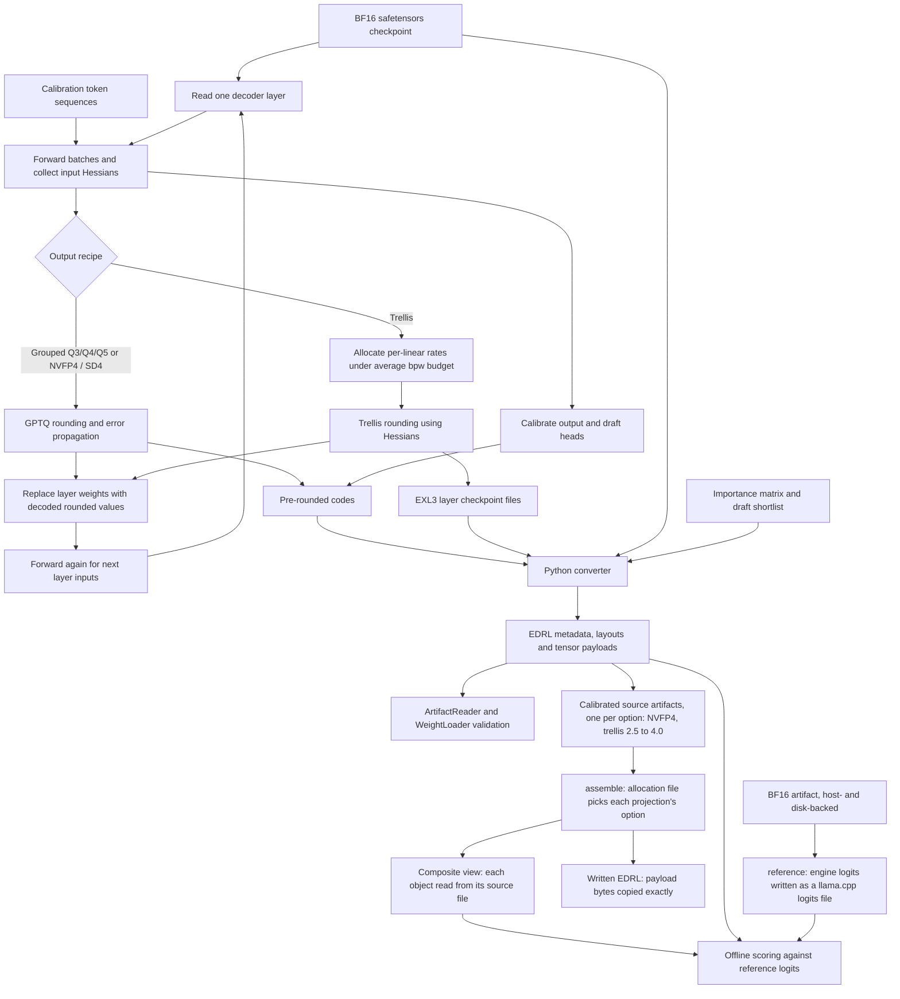

# Quantization and artifact creation

This diagram covers the offline dense Qwen3.8 pipeline. Calibration learns rounding from activations; conversion packs the selected representations into an EDRL artifact consumed by the engine.

The loop is layerwise: collect statistics, round, substitute decoded weights and propagate the resulting activations. Hidden states live in pinned host storage and support resume checkpoints. Calibration work runs as lattice frames with CUDA streams; cuBLAS/cuSOLVER and quantization CUDA kernels supply the numerical work.

`Recipe` determines tensor roles and storage rules. GPTQ writes codes read by `--codes-from`. Trellis allocation assigns rates to budgeted linears, and `Exl3Writer` writes the checkpoint used by `--trellis-from`; output and draft heads have their own rounding path. The converter handles embeddings and packs metadata plus payloads, using importance weights where applicable. Check the [quantization guide](../../quantization/README.md) for format-specific head and MTP handling.

## Mixed artifacts and references

`assemble` builds a mixed artifact from calibrated sources without recalibrating: `Sources` opens one artifact per option, checks that the objects taken straight from the checkpoint (norms, GDN state tensors, the small BF16 projections, the draft-head shortlist) are bit for bit the same in every source and that the projections are the same linears, and takes every unlisted object, the heads, the embedding and the MTP drafter from the base. A chosen projection brings its companions (trellis `suh`, `svh`, `segments`) from its own source. The composite view runs in process through the engine's per-object source files; a written artifact copies the payloads exactly.

`reference` runs the BF16 artifact in the engine, its weights spread over device, pinned host memory and disk as the residency planner splits them, forces each chunk of a text as `score` does, and writes the logits at the scored positions in llama.cpp's format (logits clamped 16 below the largest, 16-bit codes), so `score` compares the engine with itself. `Scorer` loads, scores and unloads one artifact at a time on one device and lattice, for callers that score many.

## Allocation and RCO terminology

The implemented bit allocation here is [trellis Allocation](../../quantization/src/main/java/io/euhedral_execution/inference/quantization/trellis/Allocation.java), ported from exllamav3 and driven by an average bits-per-weight budget. The converter documentation also names external `GSQ-RCO-GGUF` repositories as sources of importance matrices. Those names do not establish a local RCO optimizer: no separate RCO allocation stage is shown because the inspected calibration and converter code does not expose one.

## Implementation anchors

- [QuantizationMain](../../quantization/src/main/java/io/euhedral_execution/inference/quantization/QuantizationMain.java), [Calibrate](../../quantization/src/main/java/io/euhedral_execution/inference/quantization/Calibrate.java), [CalibrationLattice](../../quantization/src/main/java/io/euhedral_execution/inference/quantization/CalibrationLattice.java) and [Recipe](../../quantization/src/main/java/io/euhedral_execution/inference/quantization/Recipe.java).
- [GPTQ](../../quantization/src/main/java/io/euhedral_execution/inference/quantization/gptq/Gptq.java), [TrellisQuantizer](../../quantization/src/main/java/io/euhedral_execution/inference/quantization/trellis/TrellisQuantizer.java) and [Exl3Writer](../../quantization/src/main/java/io/euhedral_execution/inference/quantization/trellis/Exl3Writer.java).
- [Assemble](../../quantization/src/main/java/io/euhedral_execution/inference/quantization/mixed/Assemble.java), [Sources](../../quantization/src/main/java/io/euhedral_execution/inference/quantization/mixed/Sources.java), [ReferenceLogits](../../quantization/src/main/java/io/euhedral_execution/inference/quantization/ReferenceLogits.java) and [Scorer](../../quantization/src/main/java/io/euhedral_execution/inference/quantization/Scorer.java).
- [Converter entry point](../../tools/convert_checkpoint.py), [converter package](../../tools/euhedral_artifacts), [tools guide](../../tools/README.md) and [Score](../../quantization/src/main/java/io/euhedral_execution/inference/quantization/Score.java).

This diagram omits training/rotation commands, individual quantizer kernels, format byte layouts and the separate Flash-Next converter path. It makes no quality or throughput claim.
