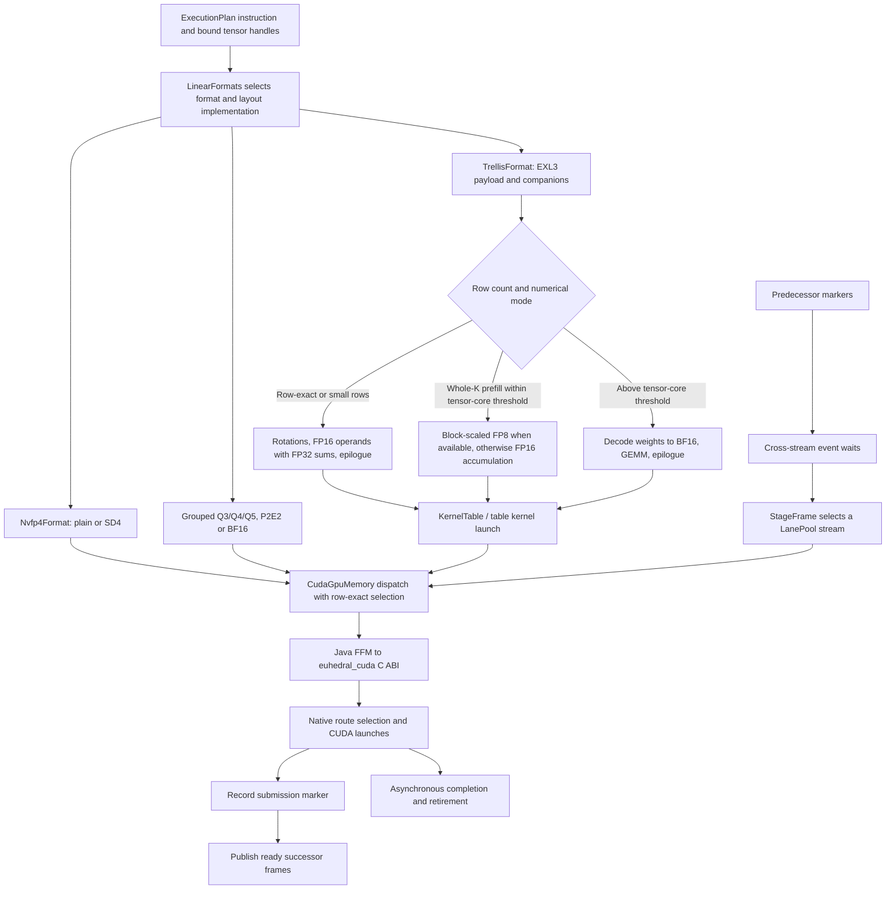

# CUDA execution

This diagram shows dense linear dispatch and device ordering. Artifact format, layout, row count and the quantum's numerical contract select the route. Attention, GDN and elementwise stages use the same stream and dependency machinery but have their own kernels.

`CudaGpuMemory` binds the stable C ABI through Java's Foreign Function and Memory API. Device addresses are opaque longs. Kernel launches use the stream selected for the calling stage; direct operations without a selected stream are synchronous diagnostic paths.

NVFP4 dispatch distinguishes its plain and compressed scale layouts and selects compatible kernels. Production multi-row prefill can use accelerated numerical routes; verification requires row-exact execution. Optional native routes can report unavailable so a supported fallback can run. Row-exact verification and diagnostic scalar exact numerics are distinct contracts.

Trellis weights carry the packed object plus rotation and segment companions. Small-row execution uses rotations, FP16 operands and FP32 sums on the trellis tensor-core path. At the whole-K threshold, production prefill uses block-scaled FP8 kernels when available, otherwise the FP16 whole-K kernels; verification retains FP16 operands and FP32 sums to match one-row execution. Above `kernels.trellis.tensor-core-max-tokens`, non-row-exact launches decode weights into BF16 scratch and run GEMM. The defaults keep the full 512-row prefill chunk on the tensor-core route, with whole-K blocks from 64 rows and wider blocks from 128. `TrellisSettings` derives thresholds from the settings tree and device geometry.

A stage first awaits predecessor markers from other streams, then submits work and satisfies submission edges. This permits successors to enqueue GPU work before earlier device work finishes, while preserving CUDA dependencies. Retirement waits for completion before publishing the quantum's outcome and recycling storage. Eligible shapes can replay a captured CUDA graph instead of repeating stage submissions.

## Implementation anchors

- [LinearFormats](../../core/src/main/java/io/euhedral_execution/inference/core/artifact/format/LinearFormats.java), [Nvfp4Format](../../core/src/main/java/io/euhedral_execution/inference/core/artifact/format/Nvfp4Format.java), [TrellisFormat](../../core/src/main/java/io/euhedral_execution/inference/core/artifact/format/TrellisFormat.java) and [TrellisSettings](../../core/src/main/java/io/euhedral_execution/inference/core/artifact/format/TrellisSettings.java).
- [CudaGpuMemory](../../core/src/main/java/io/euhedral_execution/inference/core/gpu/CudaGpuMemory.java), [KernelTable](../../core/src/main/java/io/euhedral_execution/inference/core/gpu/KernelTable.java) and [C ABI](../../native/include/euhedral_cuda.h).
- [Native implementations](../../native/src), especially `trellis`, `nvfp4`, `nvfp4_native`, `q3` and `reference`.
- [StageFrame](../../core/src/main/java/io/euhedral_execution/inference/core/runtime/graph/StageFrame.java), [LanePool](../../core/src/main/java/io/euhedral_execution/inference/core/runtime/graph/LanePool.java) and [CUDA graphs](../kernels/CUDA_GRAPHS.md).

This is a dispatch map rather than an exhaustive kernel catalog. It omits block geometry, tuning measurements and native build steps.
