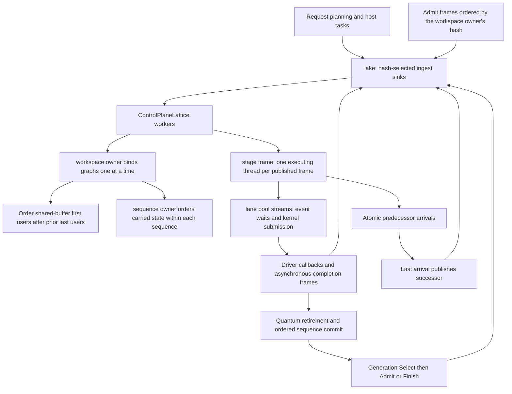

# Concurrency and ownership

This diagram distinguishes host frame routing, mutable-state ownership and device completion. It describes the shared runtime machinery and the dense execution that uses it. An owner is an ordering domain enforced by frames, not a dedicated operating-system thread.

## Ownership contracts

| Resource or state | Owner and ordering rule |
|---|---|
| Process lattice lifecycle | `InferenceEngine` claims exclusive process ownership, starts it and stops it during close. |
| Sessions and persistent sequence state | Engine tracks sessions; a generation's frame chain serializes its decisions. Sequence commit follows admitted work order. |
| Workspace access records and pass assembly | Frames ordered on the workspace owner's hash; graph binding adds dependencies for buffer reuse. |
| Carried sequence state | sequence owner records prior users per key, accessed during workspace-owner admission; separate sequences have separate records. |
| Device draft tokens and host-KV device region | Carried-state keys order draft token writers/readers and all attention layers reusing a sequence's host-page device region. |
| Host logits and proposals | Each in-flight quantum must have its own host readback buffer; an unordered proposal requires the sequence to have no other work in flight. |
| Reusable graph and storage | Runtime graph pool; returned after quantum retirement before the outcome is published. |
| Stage mutable fields | One executing thread after publication; concurrent predecessors update arrival state before publication. |
| CUDA streams and transfer lane | Runtime lane pool, shared across graphs; CUDA event waits enforce ordering across streams. |
| Host buffers used by DMA | Retained until GPU completion is proven; Host-side submission completion alone is insufficient. |

A sink routes frames by hash. The default lake uses eight sinks (`host.task-parallelism`) with one producer partition each. Equal hashes keep an ordered chain on one sink; different chains can progress concurrently. Increasing producer partitions removes ordering across producers, so the default ordering assumption matters to owner admissions. Worker placement and CUDA stream choice are separate decisions. `host.cpus` selects workers explicitly; when absent, topology and the process CPU quota determine the worker set, spreading selected cores across sockets. It does not set the CUDA lane count, which is capped at 64 using the available processor count.

Several quanta of a sequence may be admitted before any concludes when carried-state edges order their shared device data and their host buffers do not overlap. The MTP chained step uses this to pass draft tokens entirely on the device until verification retires. `Sequence` still concludes the ready prefix in admission order; a failed or partially committing predecessor prevents later work from committing across the invalid frontier.

Stages satisfy submission edges after successful device submission. Deferred stages can instead satisfy their edges when asynchronous work completes. Failures are recorded on the quantum and conclude through its continuation, including rejection handling; they must not strand a generation or leak its admitted lake unit.

Offline tools follow the same rule. The quantization module's search registers a few ingest sinks of its own on the process's lattice (`ControlPlaneLattice.getOrCreate()`), each running one queued host task per poll, beside the lake the engine uses for scoring; it completes them when the search ends. No tool starts threads of its own.

The lake counts admitted units such as generations, quanta and host tasks. Graceful completion closes admission and completes its sources after all units terminate. During normal idle periods it can detach its sinks and watch, then attach a fresh set for later work. Engine shutdown closes tracked sessions, stops the model's execution, closes the lattice, and releases model/GPU resources in the engine's shutdown order.

## Implementation anchors

- [runtime](../../rust/crates/engine/src/runtime.rs): the exclusive lifecycle claim, the lakes and close.
- [frames](../../rust/crates/engine/src/frames.rs) and [workspace](../../rust/crates/engine/src/workspace.rs): sinks, admitted units and owners.
- [generation](../../rust/crates/engine/src/generation/mod.rs) and [quantum](../../rust/crates/engine/src/quantum/mod.rs): the request and the quantum.
- [search](../../rust/crates/quantization/src/mixed/search.rs): the quantization search's ingest sinks.
- [GPU launch queue](../../rust/crates/cuda/src/launch/queue.rs) and [frame model](FRAME_MODEL.md).

This diagram omits the external Euhedral-Execution library's internal routing implementation and Flash-Next expert-cache ownership details. It documents the contracts used by this repository.
